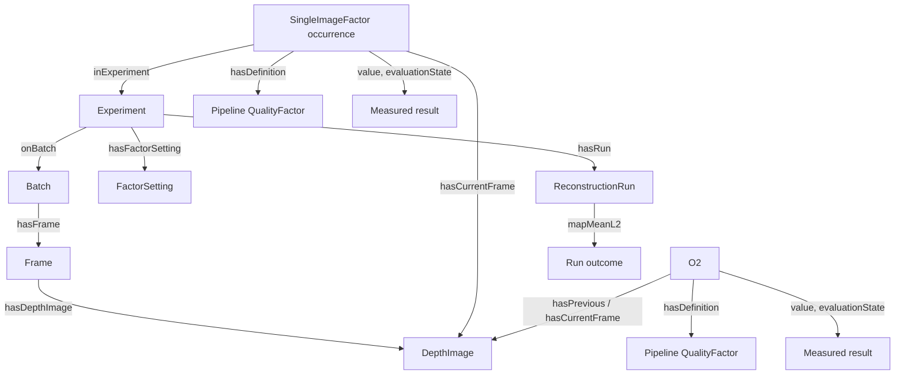

# End-to-end experiment workflow walkthrough

> **How to run one experiment from capture to report.** This is the
> experiment-centric path: a student-authored declaration, one measuring
> first-pass reconstruction that seals the evidence, inspection and plots,
> SPARQL-selected reconstructions, and the report. For command flags see
> [`reconstruct.md`](reconstruct.md) and [`api.md`](api.md); for the RDF
> recording model see [`triplestore.md`](triplestore.md); for factor contracts
> see [`factors.md`](factors.md).

Run commands from the repository root in the Habitat Pixi environment.

## 0. What you need

- A capture directory: `rgb/` + `depth/` PNGs with matching integer stems,
  plus `intrinsics.json` (`{"width", "height", "hfov"}`).
  `api.py declare` refuses skewed captures (rgb/depth stem sets differ) and
  warns on stem gaps (pairs spanning a gap read as larger motion).
- Ground truth for scoring: `GT_pose.npy` in the capture directory
  (trajectory Mean L2 only; factor measurement never touches GT).

## 1. Declare — scaffold the experiment

```bash
pixi run -e habitat python api.py declare --name <exp> --data-dir <capture> --floor <N>
```

- Creates `experiments/<exp>/` with `<exp>.ttl`, `plots/`, and `queries/`;
  the Turtle path is `experiments/<exp>/<exp>.ttl`: prefixes, one
  `hw1:Experiment` subject with `hw1:batchFile`, and `hw1:onBatch`. Pipeline-derived factors are measured
  automatically, so declarations do not select factors.
- Name rules: `[A-Za-z0-9_-]+`, file stem == Experiment IRI tail.
  `experiments/` is append-only: existing files are never regenerated over.
- Nothing is measured. The scaffold self-validates via `read_declaration`
  (batch, settings and prediction block).
- **Before assessing:** replace the PREDICTION TODOs and `rdfs:label`
  (expected pipeline-factor results, baseline outcome, selected outcome, mechanism).
  The seal makes them non-retractable — that is the point.

Preview what assessment will default:

```bash
pixi run -e habitat python api.py explore experiments/<exp>
```

View 2 shows the required setting vector before measurement: reconstruction
configuration (`icpBackend`). No factor values exist until the first
reconstruction pass. Only reconstruction configuration is stored as settings;
pipeline measurements use state already produced by the consumer.
Undeclared settings are filled from `hw1:paramDefault` below the
marker at seal time. Override with a `hw1:FactorSetting` blank node
(replace the final `.` with `;`, see the scaffold comment).

## 2. Measure & seal — the first-pass reconstruction

```bash
pixi run -e habitat python reconstruct.py --experiment experiments/<exp> --no-vis
```

The capture comes from the declared `hw1:batchFile` — no capture flag exists.
`--version` (default: recorded `icpBackend`, else `open3d`) must not disagree
with it. `--selection-query` and `--no-write` are rejected here: the
measuring run is always a full-batch run that writes.

What happens, in order (`reconstruct.py` main → `utils.reconstruct` →
`api.seal_experiment` → `api.write_run`):

1. The `pipeline_callback` records the 8 first-order pipeline factors from consumer
   state: raw and voxelized point counts per depth image; coarse RANSAC fitness,
   RMSE, and correspondence count plus refined ICP fitness, RMSE, and
   correspondence count per adjacent depth pair.
2. Coverage check: every expected pipeline-factor record — any gap is a hard error.
3. `visualize_and_evaluate` scores trajectory Mean L2 vs GT (inf when GT
   missing).
4. `seal_experiment` appends the MACHINE SECTION once: `hw1:declarationDigest`
   seal, defaulted `hw1:FactorSetting`s, one `hw1:Factor` occurrence per
   expected pipeline measurement (value, `hw1:Measured`). Occurrence links
   identify the measured depth image or ordered adjacent depth images.
5. `write_run` appends the `baseline` `hw1:ReconstructionRun`
   (`hw1:mapMeanL2`, `hw1:runFrameCount`).

The file is now SEALED. Editing above the marker makes every reader refuse
it. A new idea is a NEW file under a NEW name.

## 3. Inspect and visualize

```bash
pixi run -e habitat python api.py explore experiments/<exp>  # tables + saved plots
pixi run -e habitat python api.py explore experiments/<exp> --launch-dashboard
pixi run -e habitat python api.py explore <capture>          # batch view: frames, gaps, intrinsics
pixi run -e habitat python api.py explore experiments/<a> experiments/<b>  # comparison view
```

The assessed experiment view prints:

- Header: experiment IRI, batch, and measured/expected pipeline occurrence
  counts. The reader validates occurrence completeness while loading the file.
- Factor table: one row per occurrence, with factor name, optional previous
  frame, current frame, value, and observable.
- Summary: occurrence counts by factor, frame counts, and recorded runs.
- Run outcomes: recorded `mapMeanL2` values.
- Settings: declared vs defaulted split by marker side.

`explore` does not change the Turtle or measure new values. For assessed
experiments it writes self-contained interactive Panel/Bokeh HTML plots to
`experiments/<exp>/plots/`: `dashboard.html`, `timelines.html`,
`distributions.html`, and `tradeoff.html`. `--launch-dashboard` serves the
saved dashboard locally after writing it. The `queries/` directory is a place
to keep reusable experiment SPARQL queries. Multi-experiment exploration saves
plots for each assessed experiment; with `--launch-dashboard`, it serves them
in tabs. Declarations and captures have no measured factors to plot yet.

The tradeoff uses only recorded reconstruction runs. Since the current schema
stores one run per mode (`baseline` and `selected`), each experiment has at
most two measured points; explore does not run a sweep. The
horizontal axis is retained-frame fraction and the vertical axis is recorded
`mapMeanL2`.

## 4. Query — ask the sealed graph

```bash
pixi run -e habitat python api.py query experiments/<exp> --query-file experiments/<exp>/queries/frames.rq
pixi run -e habitat python api.py query experiments/<exp> --query-text 'SELECT ...'
```

- Local SPARQL via `rdflib`, no server. `SELECT` (table/csv/json), `ASK`,
  `CONSTRUCT`/`DESCRIBE` supported.
- Query pipeline factors directly, e.g. `hw1:hasDefinition
  hw1:VoxelizedPointYield` with
  `hw1:value ?v` / `FILTER (?v >= 200)`.
- Occurrence shape: `?o a hw1:Factor ; hw1:inExperiment <exp> ;
  hw1:hasDefinition hw1:<Factor> ; hw1:hasCurrentFrame ?img ;
  [ hw1:hasPrevious ?prev ] ; hw1:value ?v ;
  hw1:evaluationState hw1:Measured`.

## 5. Select & reconstruct — test the hypothesis

```bash
pixi run -e habitat python reconstruct.py --experiment experiments/<exp> \
  --selection-query experiments/<exp>/queries/frames.rq --no-vis
```

- The query binds `?frame` (frame IRI) or `?frameIndex` (integer); results
  are validated against the experiment's frames, sorted, cut into maximal
  contiguous segments (`cut_contiguous_segments`), then flattened into one
  selected frame list for reconstruction. Reconstruction registers each frame
  against the previous selected frame, including across segment boundaries;
  segment metadata records those splices but the segments are not run separately.
  The query defines the selection; value bands live in its `FILTER` clauses.
  The CLI does not provide an automatic selection query; express the value
  conditions in the SPARQL query when that is the selection rule you want.
- Writes: `selected` run node (`mapMeanL2`, `hw1:usedFrame`s,
  `hw1:runFrameCount`, `spliceCount`/`maxGapLength` segment metadata).
  Sealed evidence is never mutated. Empty selection → no run, no write.
- `--no-write` dry-runs the score without touching the file.
- Typical loop: query a pipeline-factor value, reconstruct the
  selected frames, and compare `selected` vs `baseline` run outcomes. Each
  tuning is a new file.

## 7. Report — what to claim

- Prediction vs outcome per experiment (sealed PREDICTION block vs measured
  values): which frames/factors read low or high, baseline band, selected
  differential, mechanism.
- Selected segmentation and its effect on trajectory Mean L2 and retained
  frame count. This workflow records trajectory Mean L2; it does not calculate
  or record map accuracy, completeness, or F-score.
- Compare factor occurrences with the recorded run outcome to form a
  diagnosis. `explore` reports factor values and run values separately; it does
  not automatically attribute a reconstruction failure to a factor or setting.
  Use the factors as evidence for hypotheses such as sparse geometry,
  degenerate normals, weak matches, or poor pair registration, then test them
  with a new capture or a measured selected run.
- Series of declarations as the lab notebook: each file is one treatment
  with its sealed evidence; the report is the series and what it returned.

## RDF graph shape

The graph has shared capture structure and experiment-scoped results.



`Factor` is the common occurrence class. `SingleImageFactor` is used for a
depth image and `DepthPairFactor` for an ordered adjacent depth pair. Run
outcomes are direct properties of `ReconstructionRun`, not quality-factor
occurrences.
