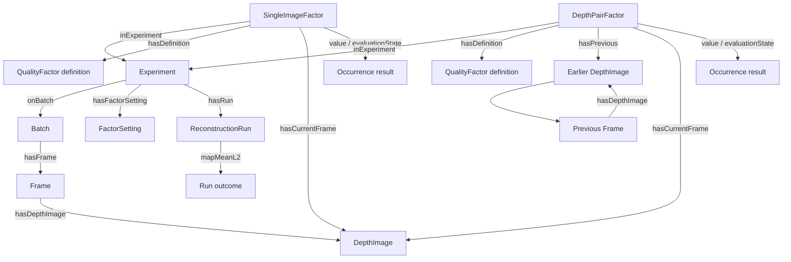

# Pipeline-derived quality factors

> **TA-internal implementation documentation.** This repository contains the
> complete homework implementation and reference materials.

The eight factors below are first-order reads from state the reconstruction
pipeline already creates: direct point counts, direct `RegistrationResult`
attributes, and `len()` of the result correspondence sets. No eigendecomposition,
variance aggregation, KD-tree search, norm, or angle conversion is recorded.
They are recorded automatically during the baseline pass for every experiment.
There are no grading thresholds in the store; selection queries state their
own value bands in `FILTER` clauses.

## Shared conventions

- Depth PNGs are uint16 millimetres; a pixel is valid iff `raw != 0`, matching
  `utils.depth_image_to_point_cloud`.
- Single-image factors are direct point counts from the back-projected cloud
  and its downsampled form. Pair factors are direct `RegistrationResult`
  attributes (`fitness`, `inlier_rmse`) and `len(correspondence_set)` from
  the RANSAC coarse alignment and the refined ICP result, per adjacent
  depth-image pair. All counts serialize as `xsd:double` so INF/NaN have a
  lexical form.
- Each result is a `hw1:Factor` occurrence typed as `SingleImageFactor` or
  `DepthPairFactor`. It links to a reusable `QualityFactor` definition, its
  experiment, and its image target(s). `value` and `evaluationState`
  describe the measured result.

## Single-image factors

| Factor | Measurement |
|---|---|
| RawPointCount | Valid (`depth > 0`) back-projected points before voxel downsampling |
| VoxelizedPointYield | Points surviving pipeline voxel downsampling (5 cm default) |

Both are direct `len()` reads of clouds the pipeline already builds; no
aggregation is recorded. Raw point count falls when depth frames lose valid
returns; voxelized yield additionally falls with sparser downsampled geometry.

## Adjacent-pair factors

| Factor | Measurement |
|---|---|
| CoarseRANSACFitness | RANSAC coarse-alignment correspondence inlier fraction |
| CoarseRANSACRMSE | RANSAC coarse-alignment inlier RMSE (m), within the 1.5 × voxel distance gate |
| CoarseRANSACCorrespondences | RANSAC result correspondence-set size |
| ICPInlierFitness | ICP correspondence inlier fraction |
| ICPInlierRMSE | ICP inlier RMSE (m), within the 1.5 × voxel distance gate |
| ICPInlierCorrespondences | ICP result correspondence-set size |

Fitness and RMSE are direct `RegistrationResult` attributes; correspondence
counts are `len(correspondence_set)` on the same result objects. Coarse values
come from the seeded RANSAC initialization, refined values from the converged
ICP result inside the same distance gate. The custom `my_icp` backend exposes
only the refined transform, so its fitness/RMSE/correspondence reads record
NaN. Like the frame factors, these run from values already available during
the baseline pass; they do not trigger a separate assessment reconstruction.

## Graph shape

Trajectory mean L2 (`hw1:mapMeanL2`) is a reconstruction run outcome. Its
value is a direct property of `ReconstructionRun`; it is not one of the eight
pipeline factors. `icpBackend` is a reconstruction setting that identifies the
implementation used by the run.

The `explore` dashboard plots recorded values per factor: timelines and
distributions. It draws no threshold lines and no Pass/Fail heatmap.
