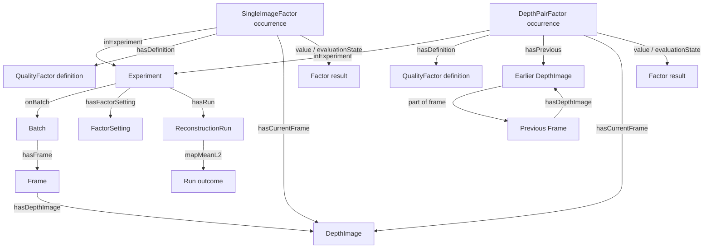

# Triple-store recording strategy

> **TA-internal implementation documentation.** This repository contains the
> complete homework implementation and reference materials.

Experiments are stored as local Turtle files and read with `rdflib`. The
ontology in `ontology/hw1.ttl` defines the terms used by declarations,
measurements, and reconstruction runs.

`api.py declare --name <name>` creates `experiments/<name>/` with
`<name>.ttl`, `plots/`, and `queries/`. The directory is the experiment path
used by `explore`, `query`, and `reconstruct.py --experiment`.

## Big picture

Each file contains a single RDF graph. Batch, frame, and image IRIs identify
shared capture structure. Factor occurrences, factor settings, and run records
are scoped to one experiment, so two experiments can assess the same images
without overwriting each other's results.

`Factor` is the common occurrence class. Single-image factors measure a depth
image; depth-pair factors measure an ordered pair of adjacent depth images.
Each occurrence links to its reusable definition, its experiment, and its image
targets. Generic `value` and `evaluationState` properties record the result.
The reusable definition's `overProperty` metadata tells the reader what the
value represents. Selection queries carry their own value bands in `FILTER`
clauses; nothing in the store grades a value.

`mapMeanL2` is a direct property of `ReconstructionRun`. It is not a member of
the pipeline QualityFactor set.

## Namespaces and instances

The ontology namespace is `http://taica.course/hw1/ontology#` (`hw1:`).
Capture structure uses `http://taica.course/hw1/data/`: for example,
`data:batch/<batch>/frame/<index>` and `data:batch/<batch>/depth/<index>`.
Experiment records use `http://taica.course/hw1/experiment/`: an experiment
is `exp:<name>`, with its factor occurrences, settings, and runs beneath that
IRI. The ontology uses `schema:contentUrl` to locate image files and QUDT terms
for units.

Frame indices are integer file stems, written as unpadded decimal values.
Ordering uses integer indices rather than lexical IRI order. A pair occurrence
links the earlier image with `hasPrevious` and the later image with
`hasCurrentFrame`.

## File lifecycle

An experiment file has a student-authored declaration, a machine marker, and a
machine-authored section. The declaration identifies the batch and records
setting overrides. The first baseline reconstruction measures all eight
pipeline factors and appends their occurrences and defaulted settings, together
with the baseline run. The declaration digest seals the student-authored bytes;
subsequent run writes preserve that declaration and its factor evidence.

A factor occurrence is complete when its evaluation state is `Measured` and it
has a value. The occurrence set is checked against the expected
pipeline factor and image targets when read.

## Parameters

Parameter declarations and factor definitions come from the ontology. The only
setting role is `ReconstructionSetting`, which identifies a reconstruction
configuration such as `icpBackend`.

The eight factor definitions use `overProperty` metadata; the occurrence
itself stores its result in the generic properties. The Turtle serializer
may change the lexical form of an `xsd:double`, so values are rounded to the
stored precision and written through the shared double literal helper.

## Reading and selection

Selection queries return frame IRIs or integer frame indices. Results are
validated against the experiment's capture and sorted by integer index. The
reconstruction CLI records contiguous segments for splice metadata, then
flattens the frame list: registration proceeds from each selected frame to
the previous selected frame, including across gaps. A selection query controls
which frames are consumed; value bands live in the query's `FILTER` clauses.

## Reconstruction runs

A run records its selection mode, frame count, and `mapMeanL2` outcome.
A selected run also records consumed frames with `usedFrame` and its segment
`spliceCount` and `maxGapLength`. The current reconstruction writer does not
compute map coverage scores. Run writes update the run's own records and
preserve factor occurrences.

## Batch graph and declaration

`batch2ttl` writes shared capture structure: batch, frames, and image nodes.
`declare` scaffolds the experiment declaration with the batch link, settings,
and prediction prompts. The reader validates known parameters, required
settings, and the expected pipeline occurrence set.

## Function index

| Area | Functions |
|---|---|
| IRI minting | `batch_iri`, `frame_iri`, `component_iri`, `data_*_iri` |
| TBox | `load_parameter_declarations`, `load_quality_factors`, `parse_setting_arg` |
| Numbers | `_storable`, `_double_literal`, `_setting_value_literal`, `_setting_value_to_python` |
| Marker + seal | `_marker_offset`, `_split_sections`, `_declaration_digest`, `_verify_seal` |
| Machine section | `build_machine_graph`, `seal_experiment`, `write_run` |
| Reading + selection | `read_experiment`, `query_graph`, `frames_from_sparql_query`, `cut_contiguous_segments` |
| Declaration + batch | `cmd_declare`, `read_declaration`, `build_batch_graph`, `cmd_batch2ttl`, `cmd_explore`, `cmd_query` |
